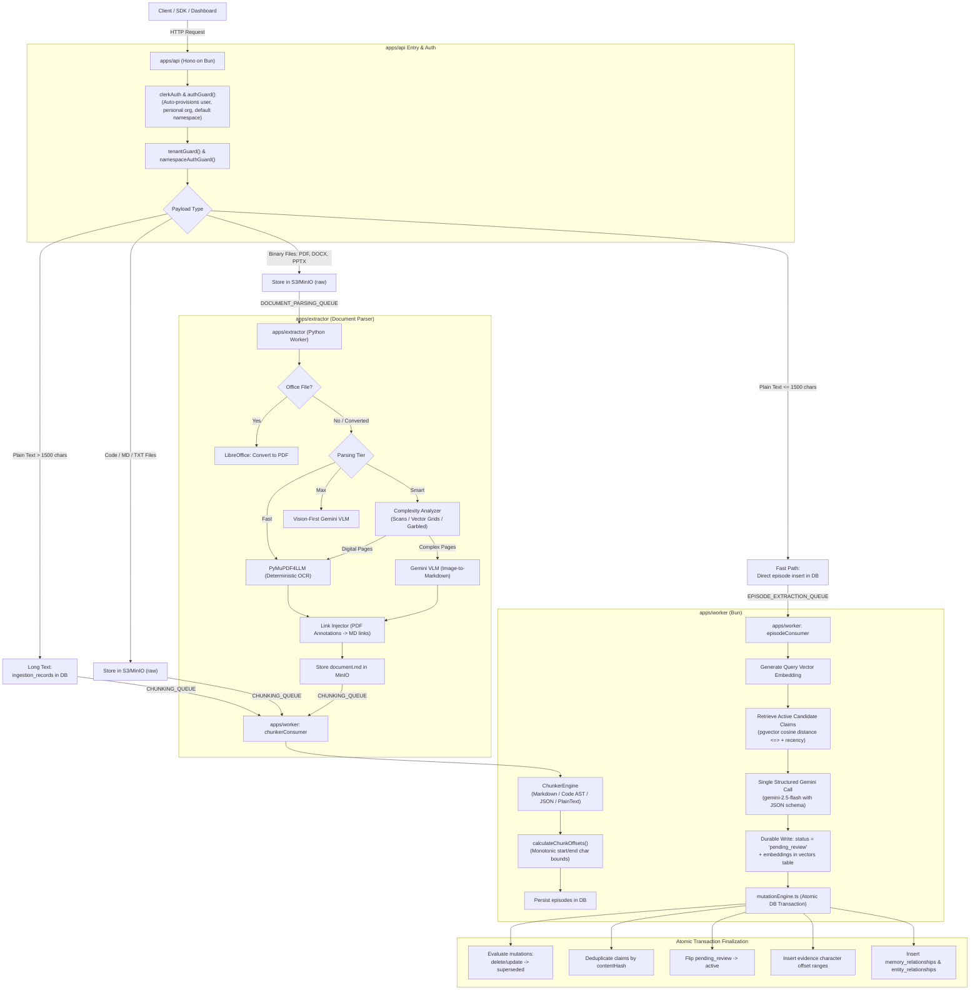
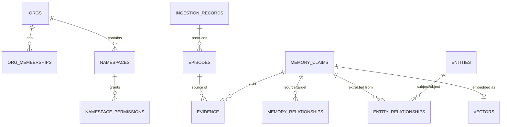

# Whimsync — Master Architecture & Data Contracts

> **Canonical System Specification**
> Documents the complete, active architecture implemented across `apps/api`, `apps/extractor`, `apps/worker`, and `packages/db`.

---

## 1. System Overview

Whimsync is a stateful, explainable AI memory and context engine designed for AI assistants, coding agents, and multi-tenant applications.

### Core Implemented Capabilities
- **Single-Call Cognitive Extraction:** Evaluates an incoming episode against prior candidate claims in a single structured Gemini call, proposing claims, semantic relationship edges, entity quintuplets, and mutations.
- **Explainable Evidence Citations:** Every extracted claim links directly to immutable character offset ranges in source episodes via authoritative `evidence` records.
- **Multi-Stage Document Ingestion:** Handles plain text (fast-path <= `FAST_PATH_CHAR_LIMIT` / 1500 chars), code/text files, and complex binary documents (PDF, DOCX, PPTX) via a Python layout parser and AST-aware chunking pipeline.
- **Unified Multi-Tenant Scoping:** Built from day one on a flat tenant contract (`Every account is an org`) where organizations and namespaces form strict isolation boundaries.
- **Postgres + pgvector Knowledge Store:** Leverages PostgreSQL with `pgvector` HNSW cosine similarity indexing (`vector_cosine_ops`) for low-latency claim retrieval.

---

## 2. Global Topology & Ingestion Pipeline



---

## 3. Scoping & Access Control Contract

Whimsync enforces a strict, unified organization model: **Every account is an org.**

### Flat Column Contract
Every memory record contains explicit, indexed scoping columns:

| Column | Nullable | Default | Role |
|---|---|---|---|
| `tenant_id` | No | None (Must be explicit) | **Security Boundary:** Every claim belongs to exactly one organization. |
| `namespace` | No | `"default"` | **Access Control Boundary:** Isolation unit. Memories cannot cross namespaces. |
| `user_id` | No | None (Must be explicit) | **Authorship:** Identifies the user who initiated the ingestion. |
| `entity_key` | Yes | None | **Scoping Tag:** Optional subject identifier (e.g. `customer:123`). |
| `session_id` | Yes | None | **Lifecycle Tag:** Optional session identifier. |

### Roles & Namespace Permissions
- **`role: owner`:** Exactly one per organization. Possesses complete administrative authority.
- **`role: admin`:** Automatically bypasses namespace permission checks with full read/write access to all namespaces within the organization.
- **`role: member`:** Default-deny. Access to a namespace requires explicit permission rows in `namespace_permissions` (`can_read`, `can_write`).
- **No Cross-Namespace Relationships:** `memory_relationships` and `entity_relationships` edges connect claims strictly within the same namespace. Edges never span across namespaces.

### Automatic Provisioning Flow (`findOrProvisionUser`)
When an authenticated Clerk user makes their first API request:
1. `authGuard` intercepts the request and verifies the session token.
2. If the user does not exist in PostgreSQL, an atomic transaction:
   - Inserts the `users` row.
   - Creates a personal organization in `orgs` (e.g., `"<Name>'s Org"`).
   - Assigns the user as `role: "owner"` in `org_memberships`.
   - Provisions the `"default"` namespace in `namespaces`.
   - Grants full `can_read` and `can_write` in `namespace_permissions`.

### Lifetime Framing
- **Conversation:** In-flight message buffer before extraction runs.
- **Session-scoped Memory:** Claims tagged with `session_id` representing temporary interaction context.
- **Durable Memory:** Long-term claims where `session_id` is null, persisting indefinitely within the namespace.

### Timestamp Semantics
- `occurred_at`: Real-world event time (when the fact was actually true in the world).
- `recorded_at`: System write time (when the row was first written; immutable).
- `updated_at`: System update time (bumped whenever the row is modified).
- **Bitemporal Tracking (`memory_relationships` & `entity_relationships`):**
  - Event time (`valid_at`, `invalid_at`): Was this relationship statement true in reality during this interval?
  - Transaction time (`tx_created_at`, `tx_expired_at`): When did the system believe this relationship was true?

---

## 4. Pipeline Stages & Queue Topology

Redis serves purely as **transient queue plumbing** via BullMQ. All large files and intermediate artifacts use the **Claim Check Pattern** via S3/MinIO.

### S3 / MinIO Key Structure
```
uploads/{tenantId}/{namespace}/{ingestionId}/
├── raw.{ext}          # Original uploaded file
├── converted.pdf      # Normalized PDF (if converted from DOCX/PPTX)
└── document.md        # Parsed Markdown from layout extraction
```

### Stage 1: API Gateway (`apps/api`)
- `POST /v1/memories`: Accepts plain text. If <= `FAST_PATH_CHAR_LIMIT` (1500 chars), stores directly into `episodes` and enqueues to `episode-extraction`. If > 1500 chars, writes to `ingestion_records` and enqueues to `chunking`.
- `POST /v1/memories/upload`: Accepts multipart file uploads. Calculates SHA-256 hash for deduplication. Novel files are stored in MinIO. Binary documents (`.pdf`, `.docx`, `.pptx`) are dispatched to `document-parsing`. Text and code files are dispatched directly to `chunking`.

### Stage 2: Binary Document Parser (`apps/extractor`)
- **Office Conversion:** Headless LibreOffice converts `.docx`, `.pptx`, `.xlsx` to standardized PDF.
- **Tier-Based Layout Parsing:**
  - `Fast`: Deterministic PyMuPDF4LLM extraction with inline link injection.
  - `Smart`: Dynamic page complexity analysis (`text_coverage`, `image_coverage`, `vg_coverage`, `is_garbled`, `full_page_image`). Clean digital pages use PyMuPDF4LLM; complex, scanned, or vector table pages route to Gemini VLM with GitHub-flavored table layout instructions.
  - `Max`: Vision-dominant layout parsing routing non-trivial pages to Gemini VLM.
- **Link Injection:** Extracts PDF annotation URIs and injects them as Markdown links.
- **Handoff:** Saves `document.md` to MinIO, updates `ingestion_records`, and enqueues to `chunking`.

### Stage 3: Chunker Pipeline (`apps/worker`)
- **Syntax Routing:** Dispatches content dynamically based on extension and syntax detection:
  - Markdown: Header-aware AST splitting preserving hierarchical `# Heading` paths.
  - Pure Code: AST-aware function/class boundary splitting.
  - JSON: Object/array boundary-aware splitting.
  - Plain Text: Paragraph and sentence fallback splitting.
- **Monotonic Offsets:** `offsetCalculator.ts` computes sequential character offsets (`chunkStartOffset`, `chunkEndOffset`) across the original text.
- **Persistence:** Batch inserts chunks into `episodes`.

### Stage 4: Cognitive Extraction & Mutation Engine (`apps/worker`)
- **Candidate Prior Retrieval:** Generates a 768-dimension embedding (`text-embedding-004`) for the episode text. Retrieves active candidate prior claims from PostgreSQL using `pgvector` cosine distance (`<=>`) and recency.
- **Single Structured Call:** Prompts `gemini-2.5-flash` with candidate claims and episode text, constrained by a JSON Schema. Proposes:
  - `claims`: Proposed memory claims with temporary IDs.
  - `memoryRelationships`: Semantic edges (`UPDATES`, `EXTENDS`, `SUPPORTS`, `CONTRADICTS`, `DERIVES`, `MENTIONS`).
  - `entityRelationships`: Subject-predicate-object-scope quintuplets.
  - `mutations`: Proposed actions on prior candidate claims (`update`, `delete`, `noop`).
  - `evidence`: Verbatim substrings from source text.
- **Pending Review Buffer:** Inserts new claims into `memory_claims` with `status = 'pending_review'` along with their vector embeddings in `vectors`.
- **Atomic Mutation Evaluation:** Inside a single database transaction (`db.transaction`):
  1. Applies mutations: sets updated/deleted prior claims to `status = 'superseded'`. Replacement claims receive an `UPDATES` relationship edge.
  2. Content-hash deduplication: checks for active claims matching SHA-256 `contentHash`. If a duplicate active claim exists, the pending claim is purged and relationships are remapped.
  3. Status transition: flips remaining new claims from `pending_review` -> `active`.
  4. Inserts evidence citations linking active claims to the episode.
  5. Inserts relationship edges into `memory_relationships`.
  6. Upserts entities in `entities` and inserts quintuplets into `entity_relationships`.

---

## 5. Database Schema (PostgreSQL + pgvector)



### Table Definitions

1. **`users`:** Clerk user identity profile (ID, name, email, avatar).
2. **`orgs`:** Tenant organization boundaries (`id`, `name`, `created_at`).
3. **`org_memberships`:** User memberships within organizations (`org_id`, `user_id`, `role: 'owner' | 'admin' | 'member'`).
4. **`namespaces`:** Access-control isolation units within organizations (`org_id`, `name`).
5. **`namespace_permissions`:** Granular member permissions (`org_id`, `namespace`, `user_id`, `can_read`, `can_write`).
6. **`ingestion_records`:** Tracking records for files and text ingestion (`tenant_id`, `namespace`, `source_type`, `storage_key`, `file_hash`, `status`, `parsing_tier`, `total_chunks`).
7. **`episodes`:** Raw, immutable input text chunks (`id`, `raw_text`, `user_id`, `session_id`, `source_ingestion_id`, `chunk_index`, `chunk_start_offset`, `chunk_end_offset`, `heading_path`).
8. **`memory_claims`:** Atomic factual statements (`id`, `tenant_id`, `namespace`, `user_id`, `entity_key`, `session_id`, `content`, `kind`, `status: 'pending_review' | 'active' | 'superseded' | 'deleted'`, `confidence`, `categories`, `content_hash`, `occurred_at`, `recorded_at`, `updated_at`).
9. **`memory_relationships`:** Semantic relationship edges between claims (`source_claim_id`, `target_claim_id`, `relation`, `confidence`, `reason`, `tenant_id`, `namespace`, `valid_at`, `invalid_at`, `tx_created_at`, `tx_expired_at`).
10. **`evidence`:** Exact character offset citations into episodes supporting claims (`claim_id`, `episode_id`, `start_offset`, `end_offset`, `excerpt`, `bboxes`, `confidence`).
11. **`entities`:** Canonical semantic entities deduplicated via unique index on `(tenant_id, namespace, canonical_name)`.
12. **`entity_relationships`:** Subject-predicate-object quintuplets derived from claims (`subject_entity_id`, `predicate`, `object_entity_id`, `object_literal`, `scope`, `rationale`, `source_claim_id`).
13. **`vectors`:** 768-dimensional dense vector embeddings with an HNSW cosine similarity index (`vector_cosine_ops`).
